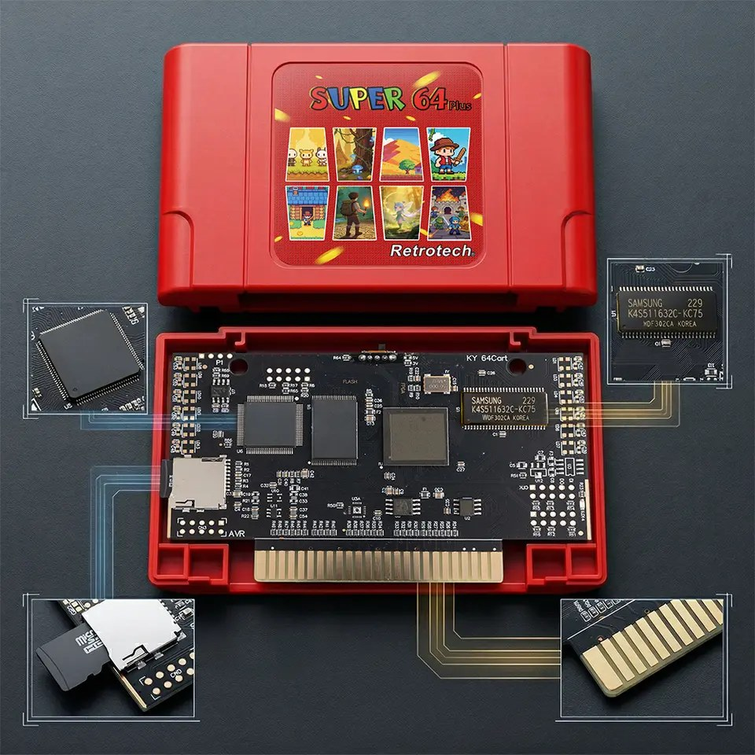
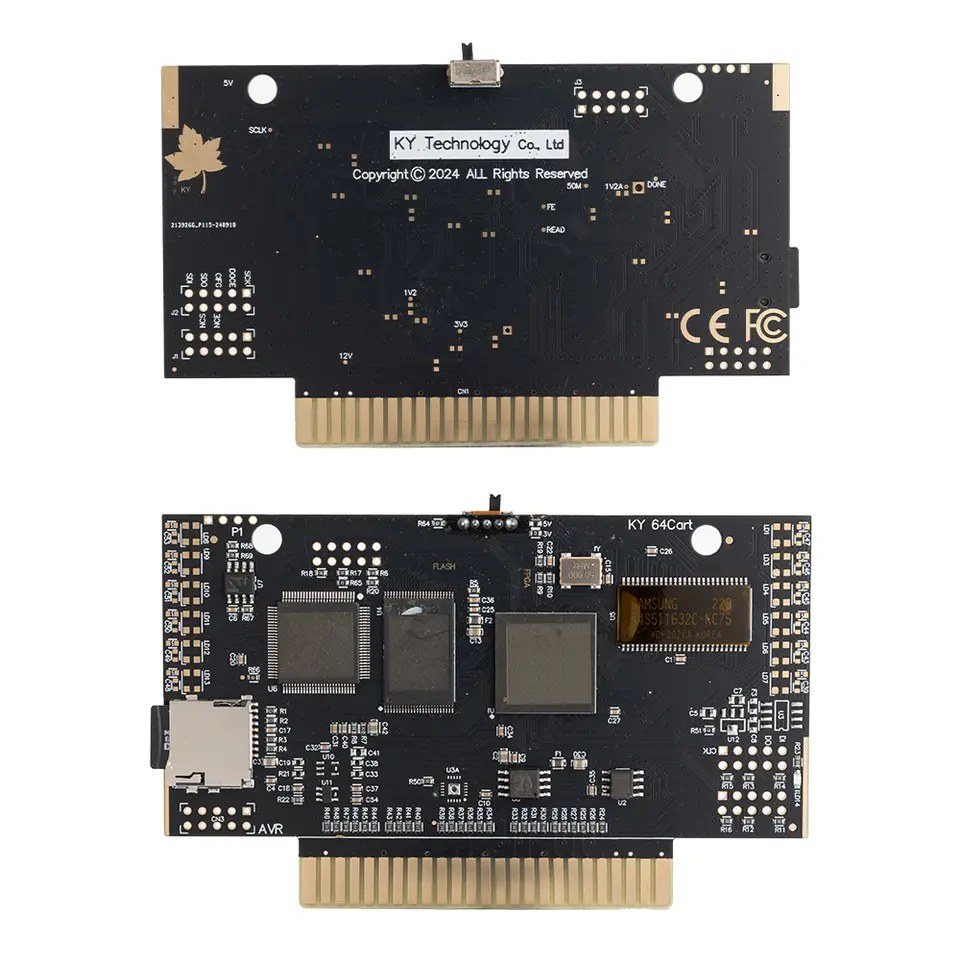

# Super64-OS

A custom menu OS for the **Super 64**, an ED64Plus-compatible flash cartridge for the Nintendo 64. It is a fork of [Altra64](https://github.com/ariahiro64/altra64), reworked to run correctly on the Super 64.

---

## Hardware

| Item | Value |
|---|---|
| Cartridge | Super 64 (ED64Plus), bootloader `ED64+ bootloader`, firmware REG_VER 0x0110 |
| Registers | 0xA8040000 |
| SD card | SPI, 1-bit |
| Cart SDRAM | 64 MB, ROM space 0xB0000000 |
| Console | NTSC N64 with Expansion Pak |

The FPGA core is treated as fixed: everything here is CPU-side OS code.

## Images

<table>
  <tr>
    <td></td>
    <td></td>
  </tr>
</table>

## Install

1. Format the SD card as FAT32.
2. Back up the card's existing `ED64P` folder, then copy the `ED64P` folder from the release zip to the root of the card.
3. The bootloader loads `/ED64P/OS64P.v64` at every power-on. Nothing is written to the cartridge itself; restoring the backed-up `OS64P.v64` undoes the install.

### Card layout

```
ED64P/
  OS64P.v64     The OS
  SYS/          Settings (ALTRA64.INI), LASTROM.CFG, RECENT.LST, FAVORITES.LST,
                AUTOLOAD.CFG, SELFTEST.TXT  — delete to reset to defaults
  SAVES/        Game saves (.eep / .sra / .fla)
  CFG/          Per-game settings (ROM Config)
  CHEATS/       <ROM name>.txt cheat files (samples included)
  MEMPAKS/      Controller Pak images
  WALLPAPER/    Wallpapers
  EMU/          Emulators, not included — see below
```

### Emulators (download separately)

NES, Game Boy, Sega and MSX ROMs start through an emulator ROM in `ED64P/EMU/`, named after the file extension it handles. They are not part of this project; get them from their authors or from upstream Altra64 and rename them:

| Save as | Emulator | Download |
|---|---|---|
| `nes.v64` | NES | [Neon64](https://github.com/hcs64/neon64v2/releases) |
| `gb.v64`, `gbc.v64` | Game Boy | [Altra64 res/emulators](https://github.com/ariahiro64/altra64/tree/master/res/emulators) (`gb.v64`) |
| `sms.v64`, `gg.v64` | SMS | [Altra64 res/emulators](https://github.com/ariahiro64/altra64/tree/master/res/emulators) (`UltraSMS.z64`) |
| `msx.v64` | MSX2 | [Altra64 res/emulators](https://github.com/ariahiro64/altra64/tree/master/res/emulators) (`ultraMSX2.z64`) |

A missing emulator shows "Emulator not found" when opening a ROM file.

## Build

Toolchain: libdragon at commit `b26fce6` with its prebuilt MIPS64 GCC, plus libmad.

stb_image and inih are git submodules in `external/`, so clone with submodules:

```bash
git clone --recursive https://github.com/rockyseltzer/Super64-OS.git
```

Then build:

```bash
source build-env.sh && make
```

## Controls

| Button | Action |
|---|---|
| A | Open folder / File Menu |
| B | Back |
| Z | Main Menu |
| START | Start the last played game |
| L / R | Previous / Next page |
| Analog Stick | Navigation |
| Hold B at Power-on | Skip Autoload |

---

## Notes

**General**
- **Game saves are written to the SD card after a console reset (hardware limitation).**
- Set the NTSC / PAL switch on the cartridge to match your console; it selects the lockout chip region and is not read by the OS.
- No FPGA core and no emulators are shipped.

**File Menu (A on a file)**
- Start Game: N64 ROMs start directly. NES, GB, GBC, SMS, GG and MSX ROMs start through an emulator in `ED64P/EMU/` (not included).
- ROM Config > Use Cheats: applies the game's GameShark codes when it starts. Needs an Expansion Pak.
- ROM Config > Use Patches: applies an `.ips` or `.aps` file each time the game starts. The patch must be in the same folder as the ROM with exactly the same name (`Game.z64` and `Game.ips`). The ROM file on the card is not changed.
- Add to Favorites: adds the game to Main Menu > Favorites.
- Set Autoload: the game starts at power-on (hold B to skip).
- Set Background (on a PNG, BMP or JPG, 320x240 or 640x480): uses it as the wallpaper.

**Main Menu (Z)**
- Recently Played: the last 10 games started.
- CPak Manager: back up, restore and format Controller Paks.
- Device Info: cartridge, OS and console details.

**Options (Main Menu > Options)**
- Fast Reboot: relaunches the last played game after a console reset (hold B to skip).
- HDMI Game ID: sends the game ID to PixelFX HDMI mods.
- Cart Speed (Standard, Fast, Fastest): sets the cartridge bus timing the game reads the cart with. Fast and Fastest shorten in-game loading; Standard uses the timing in the ROM header. EXPERIMENTAL.
- SD Speed (25 MHz, 50 MHz): the SD card clock, which sets how fast a ROM is copied from the card when a game starts.
- Save Backup: keeps the three previous copies of each save (`.0002` newest to `.0004` oldest) each time a new save is written.
- Diagnostics: board self-tests, written to `ED64P/SYS/SELFTEST.TXT`.

## Known Limitations
- Diagnostics shows a warning for the save window's own read noise — expected; the OS no longer uses that path to load or back up saves.
- Not supported on this hardware: 64DD disk images and anything that needs a different FPGA core.
- Aleck 64 (CIC-5101): console-patched conversions work. Unmodified arcade ROM dumps start to a black screen.

---

## Credits

- **ED-64 IO** — Krikzz's open-source EverDrive-64 I/O library and examples: [ED64-IO.zip](https://krikzz.com/pub/support/everdrive-64/v2x-v3x/ED64-IO.zip).
- **alt64** by saturnu: [EverDrive-64 forum](http://krikzz.com/forum/index.php?topic=816.0); [parasyte/alt64](https://github.com/parasyte/alt64).
- **Altra64**: [networkfusion/altra64](https://github.com/networkfusion/altra64), [ariahiro64/altra64](https://github.com/ariahiro64/altra64), [Suprapote/Altra64](https://github.com/Suprapote/Altra64).
- **libdragon** (`src/mempak.c`, `inc/regsinternal.h` and `inc/font.h`) from [n64brew/libdragon](https://github.com/n64brew/libdragon).
- **Save-type table** (`src/save_db.c`) from [N64FlashcartMenu](https://github.com/Polprzewodnikowy/N64FlashcartMenu).
- **FatFs** R0.16 with patches 1 and 2 by ChaN, bundled in `src/ff*.c` and `inc/ff*.h`: [elm-chan.org/fsw/ff](https://elm-chan.org/fsw/ff/).
- **stb_image** v2.31 by Sean Barrett, submodule `external/stb`: [github.com/nothings/stb](https://github.com/nothings/stb).
- **inih** r63 by Ben Hoyt, submodule `external/inih`: [github.com/benhoyt/inih](https://github.com/benhoyt/inih).
- **libmad** (MP3 playback).

Thank you to everyone above for publishing their work.
